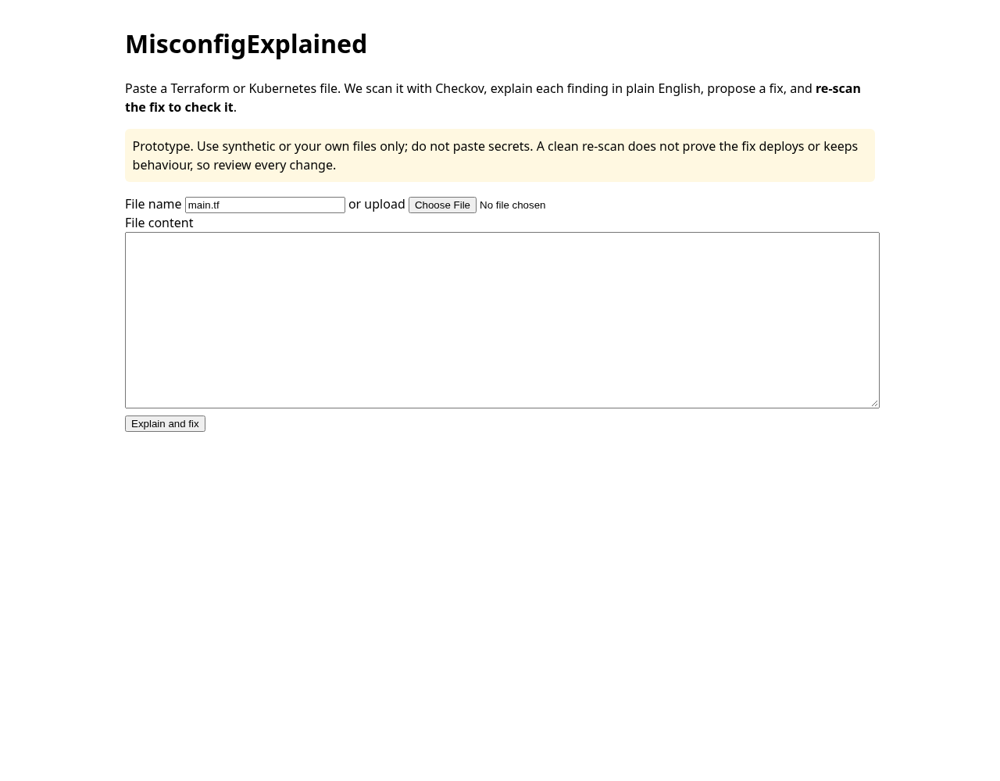
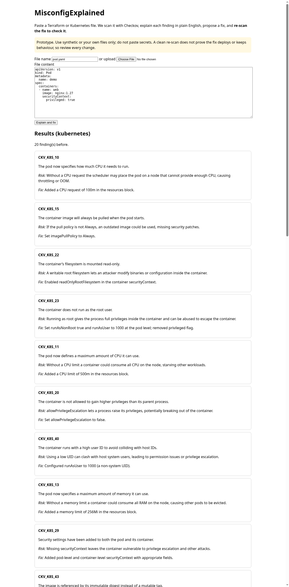

# MisconfigExplained

Plain-English explanations and **verified** fixes for Terraform and Kubernetes security misconfigurations.

1. Paste or upload a `.tf` / `.yaml` file.
2. Checkov scans it.
3. An LLM (Groq free tier, `openai/gpt-oss-120b`) explains each finding for non-experts (what it means, what could go wrong, how to fix it) and proposes a corrected file.
4. The fix is **checked, not trusted**: syntax check (YAML parse / `terraform validate` if installed), then a Checkov re-scan. The verdict is `verified`, `partial` (findings remain or new ones appeared) or `rejected` (invalid file).

## Screenshots



## Why
Research on LLM repair of IaC (our EASE study, 499 artefacts) found that scanner-passing fixes can still break deployment or change behaviour. MisconfigExplained shows the evidence instead of claiming the file is safe.

## Run (3 commands)
```bash
python3 -m venv .venv && .venv/bin/pip install -r requirements.txt
export GROQ_API_KEY=...   # free key from console.groq.com
.venv/bin/python app.py    # open http://127.0.0.1:5000
```
Tests: `.venv/bin/python -m pytest -q` (LLM is mocked; one test runs real Checkov).

## Limitations
- A clean re-scan ≠ safe or deployable. No deploy/dry-run oracle in this MVP.
- Fixes can add resources that trigger new findings (e.g. a bare S3 bucket went 7 → 16 findings in testing because added resources raised their own checks).
- Files over 12,000 characters are refused (free-tier token limit).
- Use synthetic files or files you own. Do not paste secrets; content is sent to Groq.

## Credits
Checkov (Apache-2.0), Flask, Groq API. Ideas and oracle design reused from the author's pre-existing EASE research harness. Built with AI coding assistance.

MIT licence.
